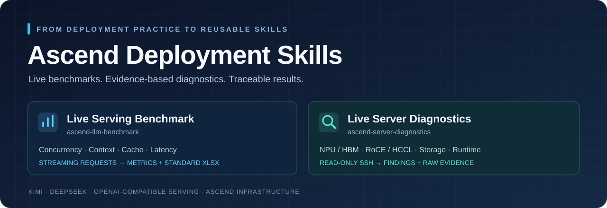
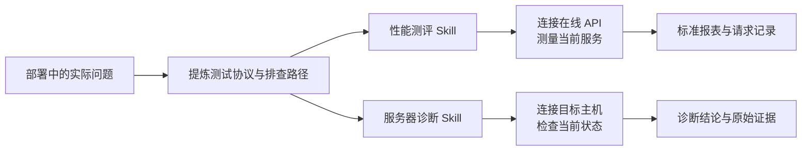

<div align="center">



[](https://github.com/PeirongLiL/ascend-deployment-skills/actions/workflows/tests.yml)


**从模型部署中的具体问题，沉淀出可直接调用的性能评测与服务器诊断方法。**

[快速开始](#快速开始) · [性能测评](#性能测评) · [服务器诊断](#服务器诊断) · [输出与证据](#输出与证据) · [验证与依赖](#验证与依赖)

</div>

## 两个 Skill，一套部署验证方法

模型上线后，需要回答两个问题：**当前服务究竟有多快？机器或集群异常究竟出在哪一层？**

本项目将 Kimi-K3、DeepSeek 部署中的测试与排障经验整理为两类 Codex Skill，并配套可独立运行的脚本。它们直接连接当前服务或服务器，执行测试与采集，再根据实际证据形成结果。

| | 性能测评 | 服务器诊断 |
| :--- | :--- | :--- |
| **Skill** | [`ascend-llm-benchmark`](skills/ascend-llm-benchmark/SKILL.md) | [`ascend-server-diagnostics`](skills/ascend-server-diagnostics/SKILL.md) |
| **连接对象** | 在线 OpenAI 兼容推理 API | 当前 Linux / Ascend 服务器 |
| **主要任务** | 并发、长上下文、缓存场景与流式时延测试 | NPU、显存、通信、存储及运行环境检查 |
| **交付结果** | 标准 Excel、指标汇总、请求级记录 | 诊断报告、设备快照、原始证据、前后对比 |
| **执行方式** | 先预检与计划，再实际发出测试请求 | 默认只读 SSH，深入验证单独执行 |



## 快速开始

### 1. 获取与安装

```bash
git clone https://github.com/PeirongLiL/ascend-deployment-skills.git
cd ascend-deployment-skills
```

将 `skills/` 下的两个目录复制到你的 Codex skills 目录，默认是 `~/.codex/skills/`。如果已存在同名 Skill，先比较版本，不要直接覆盖。

> 不使用 Codex 时，也可以直接运行下面的 CLI。核心性能脚本和 SSH 采集器只依赖 Python 标准库；Excel 导出和硬件压力验证有各自的可选依赖。

### 2. 在对话中直接调用

**测试在线模型**

```text
使用 $ascend-llm-benchmark 测当前 Kimi 服务：
输入 8192 token，每个请求输出 1024 token，并发 4，16 个请求。
先核对服务与缓存条件，测试最长 30 分钟，生成标准 Excel，不重启服务。
```

**检查当前服务器**

```text
使用 $ascend-server-diagnostics 检查 ascend-node01：
查看当前 NPU、HBM/ECC、RoCE、磁盘与运行环境。
先做只读巡检，给出异常定位与证据，不重启服务、不跑压力测试。
```

这里的主机别名和模型入口由使用者提供，仓库不包含任何真实服务器的访问配置或凭据。

## 性能测评

### 从在线请求到标准报表

**服务预检 → token 校验 → 预热 → 并发测试 → 指标汇总 → Excel**

- 查询当前 `/health`、`/v1/models` 和可用缓存指标，确认模型身份及上下文限制。
- raw completions 模式通过服务 `/tokenize` 构造精确长度的 token ID 输入，并用响应 `usage` 再次校验。
- 同时支持 completions 与 chat 流式响应；chat 模式需要提供文本并校准模板后的 token 长度。
- 区分预热与正式请求，设置整轮预算、单请求超时和失败停止条件。
- 保存测试条件与请求级测量，输出 **29 列标准化 Excel**，并另附运行条件。

| 指标 | 回答的问题 |
| :--- | :--- |
| **输出吞吐 / QPS** | 整个服务每秒完成多少输出 token、多少请求？ |
| **TTFT / TTFC** | 多久收到首个有效输出、首个正文内容？ |
| **TPOT / E2E** | 生成阶段平均每 token 多久、完整请求耗时多久？ |
| **P50 / P90 / P99** | 时延分布与尾部表现如何？ |
| **Goodput** | 每秒有多少成功请求同时满足指定 SLO？ |
| **实际 token / 完成状态** | 请求是否满足长度要求，整套工况是否完成？ |

<details>
<summary><strong>直接运行性能 CLI</strong></summary>

```bash
# 只查询当前入口，不生成 token
python3 skills/ascend-llm-benchmark/scripts/benchmark.py inspect \
  --base-url http://127.0.0.1:8000

# 复制模板后，填写当前模型、入口、缓存条件和测试规模
cp skills/ascend-llm-benchmark/assets/kimi-8k-1k.json current.json

# 先核对用例和预算，不联网
python3 skills/ascend-llm-benchmark/scripts/benchmark.py plan \
  --config current.json

# 确认参数后实际运行；输出目录必须是新目录
python3 skills/ascend-llm-benchmark/scripts/benchmark.py run \
  --config current.json --output-dir results/benchmark-001 --execute
```

模板默认要求确认 `cache_salt` 支持情况：确认服务支持后设置 `cache_salt_supported=true`；若不做隔离，改为 `cache_mode=uncontrolled` 并保留缓存条件标注。**请求隔离不等于关闭服务 Prefix Cache。**

如需鉴权，在配置中填写 `api_key_env` 的环境变量名称；鉴权值只通过环境变量提供，不写入配置文件。

```bash
# 需要 Codex 提供的 @oai/artifact-tool 运行环境
node skills/ascend-llm-benchmark/scripts/export_xlsx.mjs \
  results/benchmark-001/summary.json \
  results/benchmark-001/standard-report.xlsx
```

详细定义见 [测试协议](skills/ascend-llm-benchmark/references/protocol.md)；服务启动计时见 [启动时间口径](skills/ascend-llm-benchmark/references/startup.md)。

</details>

### 内置测试矩阵

| 配置模板 | 覆盖范围 |
| :--- | :--- |
| [Kimi 8K → 1K](skills/ascend-llm-benchmark/assets/kimi-8k-1k.json) | 输入 8192、单请求输出 1024、并发 4、16 请求 |
| [DeepSeek 曲线](skills/ascend-llm-benchmark/assets/deepseek-curves.json) | 15 档工况，最高并发 32，最长输入 131072 token，正式请求合计 1539 |

这些数字描述**模板覆盖范围**，不是对任意部署性能的承诺。入口、模型和部署条件均需按当前环境核对。

## 服务器诊断

### 从当前状态到故障证据

**识别设备 → 分层采集 → 关联证据 → 提出验证 → 修复后复测**

| 检查层 | 当前采集与分析的内容 |
| :--- | :--- |
| **NPU / HBM** | 设备身份、健康、当前及累计 ECC、隔离页、进程占用 |
| **RoCE / HCCL** | 逐卡链路与网络健康、光模块告警、端口计数器及通信验证入口 |
| **存储** | NVMe / SMART、LVM / MD、文件系统与磁盘布局 |
| **运行环境** | 驱动和固件、CPU / NUMA、内存、容器、监听端口与近期内核日志 |

报告区分 **确认异常、疑似异常、当前样本未见已识别异常、未测试**。工具缺失、权限不足或状态无法解析，不会被填成“正常”。脚本提供初筛和证据，Skill 在此基础上选择进一步检查路径。

<details>
<summary><strong>直接运行诊断 CLI</strong></summary>

```bash
# 实时 SSH，只读巡检
python3 skills/ascend-server-diagnostics/scripts/diagnose.py collect \
  --host ascend-node01 --output-dir results/diagnostics-001

# 当前网络确实需要跳板时使用，不永久修改 SSH 配置
python3 skills/ascend-server-diagnostics/scripts/diagnose.py collect \
  --host ascend-node01 --jump jump-host \
  --output-dir results/diagnostics-002

# 修复后比较同一服务器的两次实际快照
python3 skills/ascend-server-diagnostics/scripts/diagnose.py compare \
  --before results/diagnostics-001 --after results/diagnostics-002 \
  --output-dir results/comparison-001
```

可通过 `--devices 0,1,2,3` 指定已核实的设备编号，通过 `--expected-roce-devices` 标明应参与业务的端口。物理卡号与容器逻辑编号需分别核对。

显存数据回读与 HCCL 微基准有独立脚本，必须确认设备空闲及测试范围后显式执行。见 [深入验证与验收](skills/ascend-server-diagnostics/references/acceptance.md)。

</details>

### 方法来自真实排查

两类典型问题促成了这套诊断流程：一类是显存不可纠正 ECC，另一类是 **NPU 健康 OK、但 RoCE 链路 DOWN**。因此，检查既要验证数据可靠性，也要独立验证高速互联。

历史换卡验收中曾完成 **52 GiB 显存、3 轮校验、0 数据错误**。这是形成方法的实践证据，不是当前服务器状态，也不是新脚本已执行的硬件压力测试。匿名案例见 [排查经验](skills/ascend-server-diagnostics/references/cases.md)。

## 输出与证据

```text
性能测评                         服务器诊断
├── manifest.json               ├── snapshot.json
├── requests.jsonl              ├── raw.log
├── summary.json                ├── transport.log
├── report.md                   ├── findings.json
└── standard-report.xlsx        └── report.md
```

每次任务使用独立目录。性能指标可以追到请求记录，诊断结论可以追到采集项和原始行号。缺失指标保留为空，未完成工况保留未完成状态。

## 验证与依赖

### 已验证的范围

- **25 项功能回归**：HTTP/SSE、并发请求、精确长度校验、reasoning 与正文计时、预算停止、失败阻断，以及显存、链路、磁盘和缺失项的诊断判定。
- **实机只读巡检**：在一台 8 卡 Ascend 910B 服务器完成 SSH 实时采集，生成设备快照与诊断报告。
- **Excel 导出**：已在 Codex 的 Artifact Tool 环境验证导出，并检查生成结果。

测试中的 HTTP 服务是明确标记的模拟服务，**不代表模型推理性能**。本版本尚未使用新脚本完成实机模型压测、HBM 压力或 HCCL 微基准验收。

```bash
python3 -m unittest discover -s tests -v
```

| 组件 | 依赖 |
| :--- | :--- |
| 在线性能脚本 | Python 3.10+；服务支持所选 API，精确 raw 输入需 `/tokenize` |
| SSH 只读采集 | 本地 Python + OpenSSH；目标 Linux 的 Ascend 工具及可用查询权限 |
| 标准 Excel | Node.js 与 Codex 提供的 `@oai/artifact-tool`，非 Python 核心依赖 |
| HBM / HCCL 深入测试 | 目标 Ascend 环境的 `torch`、`torch_npu`；HCCL 多进程需 `torchrun` |

默认巡检不分配大量显存、不重启服务、不修改网络或磁盘布局。在线压测和深入硬件验证会产生实际负载，执行前需确认对应范围。

---

<div align="center">

**测量当前服务，定位当前问题，保留可复核的证据。**

</div>
